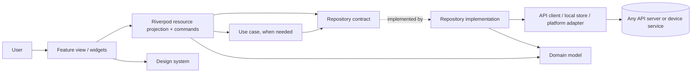
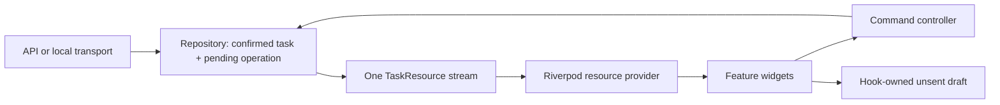
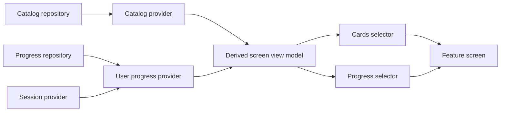
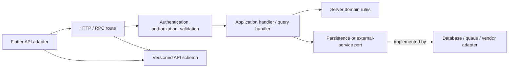
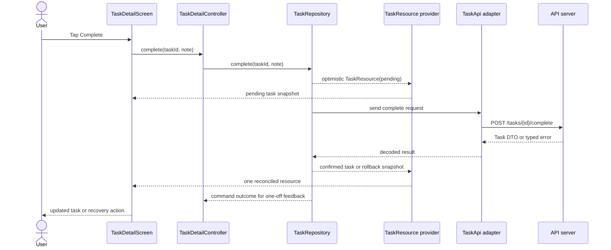

# A practical Flutter architecture for a new mobile app

**Status:** Canonical ownership and lifecycle contract for this starter. The task
reference is implemented with synthetic accounts and an in-memory server. The
broader production capabilities described below require their own adapters and
device evidence; they are not implied by the starter's tests.

## Enforced ownership in this repository

| Boundary | Current path | Allowed responsibility |
|---|---|---|
| Domain | `example/lib/features/*/domain/` | Pure Dart models and repository contracts |
| Application, when needed | `example/lib/features/*/application/` | Business operations over domain contracts, never concrete adapters |
| Infrastructure | `example/lib/features/*/infrastructure/` | API adapters, persistence/device access, repository reconciliation |
| Presentation | `example/lib/features/*/presentation/` | Contract-typed state projections, local drafts, and callbacks into ui components |
| Composition | `example/lib/app/`, `example/lib/main.dart` | Provider overrides, concrete adapter assembly, routes, session gates |
| Design system | `packages/ui/`, `example/lib/design_system/` | Visual components, layout, tokens, interaction and accessibility; app branding |
| Shared domain utilities | `packages/core/` | Pure Dart sessions, failures, diagnostics |
| Localization | `example/lib/l10n/` | Labels and safe failure-to-text mapping |

Short `AGENTS.md` files identify the owner at each boundary and refer back here.
They do not maintain separate architecture rules. The current task flow needs no
application use-case class: presentation invokes the repository contract and
infrastructure owns reconciliation. Add orchestration only when a business rule
requires it.

`tool/architecture.json` is the machine-readable dependency policy.
`tool/check_boundaries.dart` parses Dart syntax and checks every import, export,
conditional alternative, and part across the production source roots. It rejects
unclassified paths, missing local dependencies, cross-feature coupling,
cross-package internal access (including relative paths), and dependency cycles.
Workspace manifests must match the checked roots; core and ui runtime
dependencies must match their allowed external packages.
External packages are explicitly allowlisted per owner; new transport or device
plugins require an infrastructure policy entry. Part files must retain their
owner. Source symlinks are rejected rather than silently skipped.

Presentation imports Flutter only with a narrow `show` list of lifecycle types.
Composition has a separate list for navigation and app bootstrap. Visual symbols
and indirect device APIs such as `Clipboard` are checked in parsed code, including
prefixed references. External framework re-exports are rejected. These are
syntactic, deterministic policy checks, not a security sandbox or a proof that
arbitrary business logic belongs in the correct layer. Review still owns business
meaning; behavior tests own observable correctness. Do not add exemptions to
accommodate misplaced code.

The reusable ui package has no core, account, repository, or provider dependency.
`SessionGate` now belongs to `example/lib/app/session_gate.dart`; applications
copy that composition boundary instead of importing it from ui. Task screens
receive navigation and optional demo controls as callbacks. Their
`taskRepositoryProvider` exposes `TaskRepository`, and app composition creates,
registers, and closes the concrete implementation. Fake failure controls are
account-bound so an action for one account cannot affect another account's next
request.

Run `bash tool/check.sh` for formatting, analysis, architecture checks and their
negative fixtures, core/UI/example behavior tests, and an independent consumer.
CI additionally compiles the example for web. Account replacement, late results,
draft disposal, keyboard actions, semantics, narrow layouts, and enlarged text
are regression targets. Native-device runs remain a separate acceptance step.

## The short version

Build the app as **feature-oriented presentation over a small domain and data core**. Flutter widgets render state and forward intent. Riverpod exposes repository-owned resources and dependency wiring. Flutter Hooks owns disposable, widget-local input and controllers. Use cases hold business operations that span repositories. Repositories alone reconcile confirmed data, refreshes, and pending writes. API, database, and platform adapters implement contracts at the outside edge. A shared design system gives screens semantic tokens and tested interaction behavior.

The server is an interchangeable implementation detail from the mobile app's point of view. It may be a conventional API, a backend for frontend, a hosted service, or an emulator. The client should speak in domain operations and a documented wire contract, never in a vendor SDK's types.



This diagram shows **runtime flow**. Source dependencies have a stricter direction: the domain defines repository contracts; infrastructure implements them. Domain code imports no Flutter, Riverpod, HTTP package, database package, or server SDK. The application layer imports domain contracts but not concrete adapters. The composition root imports everything and assembles the app.

## 1. Decide ownership before choosing packages

| Concern | Owner | Exposes | Must not own |
|---|---|---|---|
| Domain | `domain/` | entities, value objects, repository interfaces, domain failures | widgets, HTTP, JSON DTOs, database rows |
| Application | `application/` | use cases, policies, orchestration | widget lifecycle, vendor clients |
| Infrastructure | `infrastructure/` | repository implementations, API and local adapters, DTO mapping | screen state, design tokens |
| Presentation | `features/*/presentation/` | screens, view state, commands, feature widgets | raw HTTP, SQL, server JSON parsing |
| Design system | `design_system/` | theme, semantic tokens, reusable components, accessibility behavior | feature business decisions |
| App shell | `app/` | bootstrap, routing, session gates, localization, dependency composition | feature-specific persistence logic |

Do not create a class for every box in a diagram. A simple read-only screen may consume a repository through a `FutureProvider` directly. Add a use case when a rule is reused, combines repositories, needs a transaction, or is hard to express in one view controller. This matches Flutter's guidance that the domain layer is optional, while preserving a domain boundary wherever it matters. [Flutter architecture guide](https://docs.flutter.dev/app-architecture/guide)

### Suggested project tree

```text
AGENTS.md                        # root contract; leaf instructions link to this guide
CLAUDE.md                        # optional link to AGENTS.md, never a second rule set
analysis_options.yaml            # analyzer and lint policy
docs/
  architecture.md                # layer map, dependency rules, system diagrams
  style.md                       # naming, imports, errors, tests, documentation
lib/
  main.dart                         # selects environment and calls bootstrap
  app/
    app.dart                        # MaterialApp.router / CupertinoApp.router
    bootstrap.dart                  # initialize, ProviderScope overrides
    router.dart                     # routes, deep links, guards
    lifecycle.dart                  # app resume, foreground refresh
  design_system/
    tokens/                         # semantic colors, type, spacing, radii, motion
    theme/                          # light/dark ThemeData, ThemeExtensions
    components/                     # buttons, fields, cards, feedback, layout
    catalog/                        # component previews and usage examples
  l10n/                             # ARB messages and generated localizations
  core/
    error/                          # shared failure categories; no widgets
    network/                        # transport policy and connectivity signals
    observability/                  # logging, traces, analytics interfaces
    platform/                       # notifications, files, secure storage interfaces
  features/
    tasks/
      README.md                   # purpose, boundaries, flow diagram, use cases
      architecture.yaml           # optional machine-readable exports/dependencies
      domain/                       # Task, TaskId, TaskRepository contract
      application/                  # CompleteTask, if it adds meaningful logic
      infrastructure/
        api/                        # task DTOs, endpoint adapter, mappings
        local/                      # optional persisted cache
        task_repository_impl.dart
      presentation/
        task_list_screen.dart
        task_list_controller.dart    # Riverpod state and commands
        task_list_state.dart         # immutable screen state if needed
        widgets/                    # feature-only widgets
      tasks_providers.dart           # dependency composition for this feature
test/
  features/tasks/                   # domain, repository, provider, widget tests
integration_test/                  # critical complete-device journeys
```

Put code that changes for one feature beside that feature. Put code in `core/` only after at least two features truly need the same contract or behavior. The app's composition root can depend on all layers; it is the deliberate exception to the inward dependency rule. Enforce forbidden imports with a dependency check in CI rather than relying only on a diagram.

Keep feature-to-feature imports rare. A feature may navigate using a route contract or consume another feature's explicitly public capability provider; it should not reach into another feature's private screen state or data adapter. Document each permitted cross-feature edge. If many features need the same domain concept, extract that concept deliberately rather than turning `core/` into a miscellaneous folder.

## 2. Build the design system as a product API

Start with **semantic tokens**, then theme, then components, then screens. A component should expose a user-facing meaning such as `AppPrimaryButton` or `AppErrorState`, not a pile of arbitrary colors and padding values. Keep primitive palette values private to the theme. Screens use `Theme.of(context).colorScheme`, `textTheme`, and app `ThemeExtension`s for extra roles such as success, warning, and branded surfaces. Flutter's Material 3 theming is built around `ColorScheme` and `TextTheme`; use Cupertino adaptations where the product needs platform conventions. [Flutter Material guidance](https://docs.flutter.dev/ui/design/material)

Define at least these tokens:

- **Color roles:** surface, on-surface, primary, on-primary, outline, error, success, warning, and state overlays. Specify both light and dark appearances.
- **Typography:** semantic display, title, body, and label styles. Support text scaling and localization without fixed-height clipping.
- **Spacing and shape:** a small spacing scale, corner radii, borders, elevation, and minimum touch targets.
- **Motion:** durations and curves by purpose. Respect reduced-motion settings.
- **Assets:** icons, illustrations, image treatment, and fallback behavior.

Build a small component catalog: buttons, text fields, form sections, cards, navigation surfaces, empty/loading/error states, dialogs, snackbars, and skeletons. Each component documents its default, pressed, focused, disabled, loading, and error states, as well as semantics. The catalog should render at narrow and wide sizes, light and dark themes, long translated text, large text scale, and screen-reader labels. Keep feature-specific cards in the feature until a second real consumer establishes a shared contract. [Flutter adaptive design](https://docs.flutter.dev/ui/adaptive-responsive) and [accessibility testing](https://docs.flutter.dev/ui/accessibility/accessibility-testing)

Theme and component APIs are contracts. Changing a token changes many screens; review it like a public API. Visual regression tests are useful for shared components and high-value screens, but interaction and accessibility tests still matter.

The design system should also own the **ordinary asynchronous surfaces**: loading indicators, skeletons, empty states, recoverable errors, destructive confirmations, and a consistent retry action. Feature screens provide the data and the meaning of an error; shared components provide layout, semantics, focus behavior, and visual language. A screen can customize a state without reimplementing it. This is especially valuable when dozens of screens need the same treatment for loading and failure.

Make the catalog behavioral. Each shared component should have a widget test for the interaction it promises, and each first-journey screen should have a test that composes those components:

| Situation | Required behavior | Acceptance test |
|---|---|---|
| Refresh with confirmed content | Keep content visible; show a non-blocking progress cue | Start refresh while content is shown; content remains readable and actionable |
| Recoverable write failure | Restore confirmed resource state; retain the user's draft; offer a named retry | Fail the write after an optimistic frame; draft text and retry action remain |
| Pending action | Disable duplicate submission but keep the current resource visible | Tap twice before the response; one request and one pending indicator appear |
| Navigation after success or failure | Stay on the detail route until the user leaves; Back returns to the same list | Exercise success and failure, then Back, with no unexpected route reset |
| Logout or account switch | Remove old private data and reset nested routes | Switch accounts while a detail route or request is active; only the new account appears |

Test these rules in light and dark themes, at a narrow phone width, with large text and screen-reader semantics. A shared color palette does not establish a shared interaction contract.

Separate three levels of reuse. Tokens are global. Generic components such as buttons and fields are global. A card that knows a feature's domain belongs to that feature, even if it uses global tokens. Promote it only when another feature needs the same behavior, not just a similar shape. Document each promoted component's intended use, inputs, states, and accessibility contract in the catalog.

Localize user-facing strings through a generated message catalog, not literals scattered across widgets and view models. Flutter's `gen-l10n` uses ARB resources and supports placeholders and plural rules. Test right-to-left layout, long labels, date and number formatting, and large text. Bundle fonts and essential visual assets when the first screen must work without network access. [Flutter internationalization](https://docs.flutter.dev/ui/internationalization)

## 3. Give each kind of state one home

**Flutter Hooks** manages state tied to one widget's lifetime: `TextEditingController`, `FocusNode`, animation and scroll controllers, a temporary selected tab, or an input debounce. Use `HookWidget` or `HookConsumerWidget` only where hooks simplify lifecycle. Call hooks unconditionally at the top of `build`. Do not put the canonical user, cart, task list, auth session, or network mutation in `useState`; that state would disappear when the widget is disposed and could diverge from other screens. [flutter_hooks package documentation](https://pub.dev/packages/flutter_hooks)

**Riverpod** manages shared state, asynchronous reads, derived state, and dependency wiring:

| Need | Riverpod shape | Typical example |
|---|---|---|
| Stable dependency | `Provider` | repository contract, clock, formatter |
| Request/response read with an explicit refresh policy | `FutureProvider` | lookup or search result; the underlying data may change |
| Observe a changing repository resource | `StreamProvider` with auto disposal and a family | task detail with refresh and pending write |
| Live source | `StreamProvider` | connection or message updates |
| Derived immutable value | `Provider` | filtered tasks, badge count |
| Workflow state or command feedback | `NotifierProvider` or `AsyncNotifierProvider` | onboarding steps, asynchronous validation, submission status; resource data stays in the repository |
| Parameterized resource | provider family | `taskProvider(taskId)` |

Wrap the app once in a root `ProviderScope`; account isolation uses explicit session dependencies as specified below. In widgets, `ref.watch` drives rendering, `ref.read` invokes commands in callbacks, and `ref.listen` handles one-off effects such as navigation or a snackbar. Make loading, empty, success, stale, and error states explicit. Avoid a separate provider for every keystroke; form input usually belongs to the widget until submission. A family keyed by ID should usually dispose unused entries, while the repository can outlive a route and retain its confirmed resource for the current session. Provider overrides make local development and tests replace adapters without rewriting screens. [Riverpod providers](https://riverpod.dev/docs/concepts2/providers), [families](https://riverpod.dev/docs/concepts2/family), and [testing](https://riverpod.dev/docs/how_to/testing)

### Enforce a small state-management vocabulary

Use `StatelessWidget` for pure reusable leaves, `ConsumerWidget` when a widget reads providers, and `HookConsumerWidget` when that same widget also owns a local controller or effect. Hooks are local lifecycle tools, not another shared-state layer. Permit `StatefulWidget` for a specific imperative or platform lifecycle that Hooks do not express clearly; document that exception and keep its `setState` within the smallest affected widget. A blanket ban on stateful widgets would also obscure how Hooks and Flutter work. [Flutter performance guidance](https://docs.flutter.dev/perf/best-practices)

Use the table as the ordinary vocabulary. Choose `Notifier` for synchronously initialized workflow state and `AsyncNotifier` when asynchronous initialization and transitions make the workflow clearer. Both may own steps, drafts, progress, validation errors, and command results. They invoke repository operations and derive resource data from repository providers; they never own an independently writable resource cache. A simple callback can invoke a repository directly when no controller state is needed. [Riverpod provider types](https://riverpod.dev/docs/concepts2/providers)

A resource being mutable does not by itself require a stream. A request/response reader needs a documented freshness and refresh policy; shared tasks that must update together across list and detail use repository streams in this reference. Do not add a competing `FutureProvider<Task>` beside that stream. Use families for resource IDs and auto disposal for route readers. Additional provider kinds need a clear ownership and lifetime rationale, rather than proof that the ordinary set cannot express the behavior.

State belongs at the narrowest lifetime that can meet its requirements. Keep ephemeral focus, text editing, and animation in the leaf widget; lift a draft to a parent or a route-scoped owner only when siblings must coordinate; persist it through a repository only when navigation or process death must preserve it. Account resources and commands belong to the current session's repository instances. Never copy a repository resource into independently writable screen state to make it easier to display.

Place `ref.watch` in the smallest widget that renders the watched value. A screen can assemble stable layout while separate consumers render a task body, progress badge, and pending action. Pass immutable values into plain child widgets. Use a derived provider for meaningful shared calculations, and use `select` for a small field only after profiling shows avoidable rebuild work; selected data must have stable equality. A provider update should rebuild its actual consumers, not the whole route or app shell. Flutter's `const` widgets and small build methods help contain the work; rebuild counts alone are not a performance result. [Riverpod select guidance](https://riverpod.dev/docs/how_to/select) and [Flutter performance guidance](https://docs.flutter.dev/perf/best-practices)

Make stream lifetimes testable. The repository exposes one resource stream per session and resource identity; the route-scoped `StreamProvider` subscribes while watched and drops its subscription when auto disposed. The repository may retain its last-confirmed snapshot for the active account, but an upstream socket, database listener, polling timer, or custom stream controller must stop when it has no consumers unless a documented background requirement keeps it alive. Register cleanup for manually created listeners and timers with the owning provider's disposal hook or the widget Hook's effect cleanup. Account transitions close old repository instances and reject their late emissions using the session lifecycle below. A sent server command may still finish; disposal must not turn an uncertain outcome into a new operation. Test subscriber counts, closure, resubscription, and late results. [Riverpod automatic disposal](https://riverpod.dev/docs/concepts2/auto_dispose) and [refs/lifecycle](https://riverpod.dev/docs/concepts2/refs)

### Isolate accounts through one explicit session lifecycle

Use one root `ProviderScope` and a session coordinator owned by the app shell. The coordinator publishes an immutable `SessionKey(accountId, tenantId, generation)` for an authenticated session; `tenantId` is optional for products without tenants. Change the generation on logout, account or tenant replacement, and a new sign-in, including signing back into the same account. Ordinary token refresh keeps the generation. The key is an identity boundary, not a credential.

| Owner | Required dependency and behavior |
|---|---|
| Session coordinator | Owns transitions and a revocable session handle. Revoke the old handle synchronously before awaiting cleanup or credentials for the next session. |
| Account repository provider | Watches the session key, creates one repository for the active session, and registers its idempotent close operation with `ref.onDispose`. Keep the instance alive across routes; return no account repository while signed out or transitioning. |
| Resource and workflow providers | Watch the repository or session key with `ref.watch`, so a changed session rebuilds the dependency chain. A callback may `ref.read` to invoke a command; dependency setup must not capture the session with a one-time read. |
| Private route subtree | Exists only for a resolved active session and is keyed by the full session key. Replacement removes the old navigation stack, widget drafts, and effects. Render private values only when their owning session matches the active key. |
| Async operation | Captures its session handle and checks that it is still active before publishing a result, writing local data, replacing credentials, signing out, or producing a UI effect. Cancel transport work where possible; cancellation alone does not establish isolation. |

On a switch, revoke the old handle, publish a transition state, and unmount private routes. Close the old repositories and clear their private data before exposing the next session as ready. Provider disposal releases owned resources; the coordinator awaits any required asynchronous storage cleanup and reports a recoverable transition failure if cleanup fails. Do not navigate or mutate other providers from `ref.onDispose`. Recomputing a provider disposes its prior state even when automatic disposal for unused providers is disabled. [Riverpod disposal lifecycle](https://riverpod.dev/docs/concepts2/auto_dispose)

Do not carry a previous session's `AsyncValue` content into the new session's loading screen. The session gate and ownership check apply to list data, detail data, retained errors, command results, and route restoration. Credential refresh and credential deletion are serialized through the coordinator and bound to the captured session; an old refresh or 401 response cannot overwrite credentials or sign out a newer session. Server authorization still checks every request.

Test A -> B with reads, writes, and credential refresh pending; A -> signed out -> A; and a tenant switch with the same account and task ID. Assert no old content frame, draft, snackbar, navigation, credential write, or logout reaches the new session. Assert old listeners close and returning to A starts with a fresh authoritative read. In this guide, an account lifetime means this dependency lifecycle; it does not imply a nested `ProviderScope`. Nested override scopes require a separate use case and dependency design because Riverpod scoping adds complexity. [Riverpod scoping guidance](https://riverpod.dev/docs/concepts2/scoping)

### One canonical resource path

For a mutable task, the repository owns the last confirmed `Task`, an optional pending operation, and the visible optimistic overlay. It emits one immutable `TaskResource` snapshot. A Riverpod resource provider subscribes to that stream and does not keep an independently writable task copy. A controller owns only command invocation and transient action feedback. Hooks can hold an unsent form draft; that draft is user input, not a second copy of the task. A successful write reconciles inside the repository and emits one new resource snapshot. The controller neither patches a second cache nor invalidates a competing read provider.



This path is the contract to test. A refresh can change the repository snapshot without replacing confirmed content with a full-screen spinner. An optimistic completion is marked pending until the server confirms it. A failed write removes the overlay while the draft remains available for retry.

The word *provider* here means **Riverpod**, not the separate `provider` Flutter package. Choose one primary state-management system so the app has one consistent way to find and update shared state.

### Compose screen-ready view models from source providers

Keep raw resource providers distinct from presentation providers. A catalog can come from an asset, progress from a user-scoped stream, and preferences from local storage. A derived provider combines them into an immutable view model; small selector providers expose only the lists or counts that a widget needs. This gives one place for sorting, filtering, eligibility, and display status, while allowing each widget to rebuild from the data it actually consumes.



Model partial readiness deliberately. One slow badge count should not necessarily replace an otherwise useful screen with a spinner. Split independent sections into their own async values where the experience allows it, while keeping a single authoritative repository for each underlying resource. Format locale-sensitive dates and numbers at the presentation boundary with the current locale; keep locale-independent rules in the domain. Inject a clock for date-dependent rules so tests can choose the time without changing device settings.

For multi-step flows, model the steps and transitions as data or a small state machine. The controller validates the current step and chooses the next step; a `PageView` or router renders it. This is clearer than scattering branching conditions across button callbacks. Keep temporary field controllers in Hooks, but persist a draft or resume point in a dedicated provider or repository if the user must survive navigation or process death.

## 4. Keep business rules in the domain and application layers

A domain model represents a thing the app cares about: `Task`, `Account`, `Money`, `OrderStatus`. A value object validates a concept such as an ID or currency amount. Use immutable Dart objects, stable IDs, explicit nullability, and exhaustive states where a sealed type improves clarity. Domain models should contain no JSON annotations or backend field names. An API response may have `due_at`; the domain can expose `dueAt` as a `DateTime`. A database row may have a sync flag; the domain entity need not know it exists.

Repository **interfaces** express operations in the user's language:

```dart
abstract interface class TaskRepository {
  Stream<TaskListResource> watchList(TaskQuery query);
  Future<void> refreshList(TaskQuery query);
  Stream<TaskResource> watch(TaskId id);
  Future<void> refresh(TaskId id);
  Future<void> complete(TaskId id, {required String note});
  Future<void> retryCompletion(TaskId id);
}
```

`TaskResource` carries the confirmed or explicitly optimistic task plus freshness, pending, and recoverable-failure metadata. `TaskListResource` projects ordered task IDs through the same repository records and carries query freshness and pagination metadata. Neither exposes mutable cache internals. The repository creates and retains the idempotency key for an operation. Callers cannot accidentally turn a retry into a new operation by supplying a new key.

Use a typed result or a small, documented exception hierarchy at the repository boundary. Pick one convention and use it consistently. Domain failures might include `Unauthenticated`, `Forbidden`, `NotFound`, `Conflict`, `ValidationFailure`, `RateLimited`, `Unavailable`, and `UnexpectedFailure`. Keep an underlying cause for diagnostics, but show a safe, localized message to the user. Do not turn every error into an empty list.

An application use case is worthwhile when it coordinates rules across repositories or platforms. For example, `CompleteTask` can validate a transition, call the repository, schedule a local reminder change, and emit a domain event. It should accept interfaces and return domain values. A view controller calls it and decides which screen state to expose. A trivial pass-through use case adds ceremony without improving ownership.

### Give complicated features a visible pipeline

An assistant, recommendation engine, checkout, or document workflow can have many stages without forcing all logic into one notifier. Give one orchestrator ownership of the operation, then split policy into testable collaborators: input classification, context gathering, strategy selection, request construction, response validation, action handling, and state update. A strategy interface lets policy vary without changing the UI. Record each stage's input, output, failure, and cancellation behavior. Keep analytics and persistence as explicit side effects, not hidden inside widget builders.

If a server or model can suggest UI, accept only a **versioned, validated payload**. Map approved action identifiers to a registered set of native components. Verify arguments, permissions, destination routes, and asset references before rendering or invoking a tool. Show a safe fallback for unknown or malformed payloads. Remote configuration may tune prompts, content, or thresholds, but it must not grant new device powers or bypass client validation. This optional pattern is for products that actually need dynamic workflows; ordinary screens should stay ordinary Flutter widgets.

## 5. Make repositories the single source of truth

The repository implementation owns cache policy, DTO-to-domain mapping, pagination, refresh, optimistic changes, and any merge between remote and local data. The UI should never decide whether a value came from REST, GraphQL, SQLite, or a platform plugin. Each service or adapter does the narrow I/O job: HTTP requests, database queries, secure storage, push registration, or platform calls. Flutter's architecture guide treats repositories as the source of truth and services as data-source wrappers. [Flutter data-layer guide](https://docs.flutter.dev/app-architecture/case-study/data-layer)

Name the data states honestly:

- **Remote-first:** fetch from server; cache for quick redraw; show last-known data with its freshness when offline.
- **Offline-first:** local database is the read source; writes enter a durable queue; synchronization later reconciles with the server.
- **Local-only:** user data never leaves the device unless a separate export action occurs.

Choose one per feature. Offline-first is a product and conflict-resolution commitment, not a checkbox in an HTTP client. For an offline write, define the queue record, idempotency key, retry policy, conflict rule, account-switch behavior, and what the UI says while pending. Do not claim a mutation succeeded on the server before it did. [Flutter offline-first guide](https://docs.flutter.dev/app-architecture/design-patterns/offline-first)

For the first task journey, choose **remote-first with an in-memory last-confirmed value**, no durable offline queue. Make concurrency and lifetime behavior explicit before adding persistence:

| Event | Repository and provider rule |
|---|---|
| Overlapping reads | Give each refresh a generation. Only the latest initiated read may publish; a returned resource version must not regress the confirmed version. An older read cannot overwrite a later write confirmation. |
| Refresh during a write | Keep the confirmed task and pending overlay visible. A refresh may update confirmed data but cannot clear the pending operation or silently replace its idempotency key. |
| Repeated submission | Coalesce duplicate taps for the same task into the active operation. One request, one pending indicator, and one result are visible. |
| Distinct mutations | Serialize writes per resource and account, or reject a second incompatible command with an explicit busy result. Never allow response arrival order to choose the winner. |
| Provider disposal | A screen's auto-disposed subscription stops receiving snapshots. The account-scoped repository retains confirmed data while that account remains active. Disposal does not prove the server canceled an already sent request. |
| Logout or account switch | Revoke the old session handle, close its repository instances, clear private caches and pending UI, and replace private navigation as specified in Section 3. Ignore late responses and auth effects from the old session. A server may still finish an in-flight command; a later sign-in must re-read authority. |
| Retry after unknown outcome | Retry the same operation with the same idempotency key and payload. Do not treat a timeout as proof that the server rejected the write. |
| Definite rejection | On conflict or validation failure, end the old operation. Refresh or adopt the returned latest version, show what changed, and require a new user decision with a new key. |
| Process death | This small reference has no durable retry record. On restart, re-read before offering a new command. If product requirements demand retrying an uncertain write after restart, persist the operation ID, key, payload, account, and settlement before sending it. |

The failure contract is equally concrete. A failed read keeps last-confirmed content with a freshness warning and retry. A recoverable write failure rolls back the optimistic overlay, keeps the draft, and offers retry with the same key. A conflict adopts or fetches the latest task and asks the user to review it. An unauthenticated response clears the invalid session; a forbidden response denies only that operation and explains the missing permission. A malformed successful response fails closed; it never marks the task complete merely because the HTTP status was 2xx.

Keep transport DTOs separate from domain models. Decode and validate at the adapter boundary; reject missing required fields rather than letting malformed values enter providers. Generate serializers if it reduces repetitive work, but avoid adding a second generated model layer without a clear mapping need.

### Reconcile list and detail through the same entity records

For the task reference, each session's repository owns a map keyed by `TaskId`, with one confirmed record and pending overlay per task. Its session key supplies the account and tenant boundary. A list query stores ordered IDs, filter/sort parameters, cursor, and freshness; it renders those IDs through the same entity records used by detail. Immutable list snapshots are projections, not another writable task cache. List and detail may have separate subscriptions while sharing this authority. Start with a small map and query records; a general cache framework is unnecessary.

The reference API returns complete task representations with a monotonic server revision per task and a strong ETag for conditional writes. All read and mutation adapters feed one merge function. Compare revisions only within the same account, tenant, and task ID. An ETag is opaque: use it for conditional requests and equality, never numeric or lexical ordering. If another backend supplies only opaque validators, specify a reconciliation strategy that does not assume revision ordering before substituting that adapter. [HTTP validators and ETags](https://www.rfc-editor.org/rfc/rfc9110.html#name-etag)

| Case | Reconciliation rule |
|---|---|
| Older list or detail response | Reject entity revisions below the confirmed revision. A request generation orders reads for that query; it does not establish server-wide entity ordering. |
| Partial list summaries, if introduced | Represent field presence explicitly. Missing is not null. Merge only fields the payload actually supplies; older fields cannot overwrite newer fields. Mark omitted detail fields stale when a newer summary arrives and fetch full detail before exposing it as current or allowing a write based on it. |
| Pending or confirmed completion | Both views project the same overlay and confirmation. Recompute membership and ordering when the loaded query is fully evaluable locally; rollback uses the same rule. |
| Server-ranked or paginated query | Mark affected queries stale and refresh when exact membership, order, or page boundaries cannot be determined locally. Preserve usable content with its freshness state. Fence reads started before a relevant mutation so they cannot restore stale membership even when entity merges reject their older fields. |
| Deletion | Keep a tombstone or equivalent deletion fence for the session so an older response cannot resurrect the task. Do not infer deletion from absence in a page or filtered query. Define explicit deletion confirmation and any legitimate recreation in the API contract. |

Exercise the merge with a delayed list at revision 7 arriving after detail or a successful write at revision 8. Assert both views remain at 8, completed tasks do not reappear in an obsolete open-task query, and failures restore the confirmed projection. When partial summaries or deletion are added, include missing-field and resurrection fixtures in the same contract suite.

## 6. Treat the API server as a replaceable contract

The client needs a **protocol contract**, not knowledge of how the server is deployed. Write an OpenAPI description for REST, a schema for GraphQL, or a versioned RPC definition before building screens that depend on it. This document should describe the wire format and behavior, while repository interfaces describe the mobile app's domain needs. The two contracts have different owners and can evolve independently.

For each operation, record:

| Contract item | Decision to make |
|---|---|
| Identity | Stable resource IDs, ownership, and auth scope |
| Request/response | Types, required fields, nullability, enum evolution, dates and time zones |
| Pagination | Cursor semantics, ordering, end-of-list signal, page-size bounds |
| Errors | Machine code, field details, retryability, correlation/request ID |
| Writes | Idempotency, optimistic concurrency/version, partial updates, atomicity |
| Caching | ETag or version, freshness, invalidation, offline behavior |
| Security | TLS, session/token flow, least privilege, sensitive-data handling |
| Compatibility | Additive fields, deprecated fields, supported app versions, migration window |
| Operations | Timeout budget, rate limits, telemetry, maintenance behavior |

One possible REST error envelope is:

```json
{
  "error": {
    "code": "task_conflict",
    "message": "Task changed since it was loaded",
    "details": {"expected_version": 7, "actual_version": 8},
    "request_id": "req_123"
  }
}
```

The adapter maps `task_conflict` to the app's `Conflict` failure and retains `request_id` for support. The UI decides whether to reload, merge, or ask the user. The server's human-readable message is diagnostic input, not final UI copy. Do not log tokens, passwords, or sensitive payloads. Put base URL, environment name, and optional feature flags in bootstrap configuration; no feature screen should contain an environment-specific hostname.

Choose an HTTP client for the transport's actual requirements, not for the architecture diagram. Flutter documents the `http` package as a simple cross-platform option. A different client is reasonable when interceptors, cancellation, streaming, or richer controls are required. Hide the chosen client behind the API adapter. [Flutter networking guidance](https://docs.flutter.dev/data-and-backend/networking)

Authentication is its own vertical slice: `SessionRepository` exposes session state; a credential adapter stores secrets in platform secure storage; the API adapter attaches credentials; the session coordinator serializes credential refresh and prevents concurrent refresh storms. The router observes resolved session state. Logout and account switching follow the single lifecycle in Section 3, including credential cleanup and rejection of old auth effects. If durable offline writes are later added, isolate them by account and tenant and specify whether logout deletes or quarantines them. Platform permissions and push registration are adapters, not domain entities.

### Define what sensitive data may leave memory

The first task reference keeps tasks, drafts, query caches, and pending operations in memory only. Before persisting another data category, record its purpose, fields, storage location, account/tenant partition, retention limit, backup behavior, and deletion trigger. Persist the minimum needed for the feature. Credentials belong in platform secure storage; sensitive databases or files need encryption with keys protected by platform facilities, rather than keys embedded in the app. OWASP requires protection for intentionally stored sensitive data and minimizing access to sensitive resources. [OWASP storage](https://mas.owasp.org/MASVS/controls/MASVS-STORAGE-1/) and [privacy](https://mas.owasp.org/MASVS/controls/MASVS-PRIVACY-1/)

| Surface | Default policy |
|---|---|
| Credentials | Persist only credentials needed to restore an authorized session in platform secure storage. Clear the old session's credentials on logout or account replacement through the coordinator; never include secrets in ordinary preferences or exported files. |
| Task caches and drafts | Memory only for the reference; clear on logout or account replacement. Any future persistence must define encryption, retention, and account/tenant isolation before it is enabled. |
| Backups and temporary files | Exclude credentials and sensitive caches from backup/export unless an explicit recovery requirement defines their protection. Remove temporary sensitive files when the operation ends and clean abandoned files at startup. Verify platform behavior on devices. |
| Logs, analytics, and crash reports | Allowlist event names, error codes, and safe diagnostic fields at the sink boundary. Exclude tokens, request/response bodies, user text, raw task/account IDs, and unfiltered exception strings by default. Review correlation IDs for linkability and retention. |
| Permissions and third-party SDKs | Request only access needed for the chosen feature. Gate optional collection on the applicable consent choice and pass SDKs only the fields required for their purpose. |

Apply diagnostic rules to HTTP interceptors, provider observers, breadcrumbs, and crash attachments as well as the app logger. A typed error can retain its cause in memory; that does not authorize serializing the cause to telemetry. Use synthetic fixtures in development logs. Test sinks with sentinel secrets and task text and assert they never appear; test logout cleanup and partition access through fake storage, then verify secure storage and backup configuration on devices when persistence is introduced. [OWASP prevention of sensitive-data leakage](https://mas.owasp.org/MASVS/controls/MASVS-STORAGE-2/)

### Resolve session and startup state once

The router should consume one resolved status such as `initializing`, `transitioning`, `signedOut`, `needsOnboarding`, `ready`, or `sessionFailure`. The session coordinator combines credential state, profile state, and onboarding completion in one place. It prevents a route guard from making a decision using a half-loaded profile or a stale auth token. Transition and failure states expose no previous session's private content. Test every transition, including deep links received while the app initializes, logout from a nested route, and restoration after process death. Keep route names and paths in one typed or centralized route catalog. If tabs persist across feature screens, let the router's shell own that scaffold rather than rebuilding it on each route.

Bootstrap is an ordered operation: initialize Flutter bindings; parse and validate the selected environment; initialize serialization, local storage, and time-zone support as needed; create adapters and providers; then render a visible startup, recovery, or ready state. Give each required dependency a failure policy and bounded wait so the splash screen cannot hang forever. Initialize optional services after the UI is usable when possible. Request notifications, location, camera, or other permissions at the moment the user chooses a feature that needs them, with an explanation and a recovery path after denial. A push notification deep link should wait for router and session readiness, then navigate once.

Treat mobile platform work as a separate boundary. A reminder use case chooses whether the device, server, or both own delivery. The platform adapter schedules or cancels local notifications; the API owns remote push requests; the repository records the user's intended reminder state. Define time-zone behavior, recurrence expansion, duplicate prevention, permission denial, device restart, and reconciliation after edits. Test platform-specific behavior on devices as well as with Dart fakes. The same pattern applies to camera, files, biometrics, and background work: business intent stays in the application layer, OS mechanics stay in adapters.

Distinguish **build-time configuration** (API base URL, app flavor, immutable capabilities), **runtime configuration** (server-selected content or flags), and **user preferences** (theme, reminders). Validate each against a schema and expose one immutable snapshot through providers. Allow debug overrides only in development builds. Keep secret credentials out of client configuration; mobile binaries are inspectable. Provide separate development and production environments, test data, and signing identities so a developer build cannot silently write production records.

### Treat observability as a typed cross-cutting contract

Define analytics events and parameters in a catalog, then expose named methods such as `recordTaskCompleted()`. Include identifiers only when their diagnostic purpose and retention are documented under the sensitive-data policy. Shared route observers or screen-tracking hooks can record screen visits once. Dialog helpers can record open and dismiss once. This avoids spelling drift and duplicate events. Specify event ownership, privacy rules, and schema tests; do not log raw user input or sensitive payloads by default. Analytics failure should not break a user action.

Use a structured `AppLogger` interface with replaceable console and production sinks. Log an operation name, stable error code, correlation ID, and relevant safe context. Map typed failures to clear user messages in a presentation policy, while retaining diagnostic detail for support. Inject clock, ID generator, logger, analytics sink, and permission gateway where behavior depends on them; provider overrides then make tests deterministic. Keep background work and notification scheduling behind ports with explicit retry and cancellation rules.

### A matching API server layer

The first task server needs versioned list and detail reads, an idempotent completion route, authorization, and persistence. These can live in one deployable process. The diagram below separates responsibilities, not services or infrastructure that must be created immediately:



Routes translate transport input into typed commands and domain failures back into documented status codes and error envelopes. Authentication proves identity; authorization checks the requested resource and action. Application handlers own transactions and idempotency. Domain rules decide valid transitions. Persistence adapters implement server-side ports. Add a background worker only when a request must settle before longer work completes. The server publishes schema and compatibility tests; the mobile client tests its adapter against the same examples.

The mobile and server domains need not share source code. They have different responsibilities: the server protects authoritative data and invariants, while the client manages presentation, local work, and intermittent connectivity. Share the **protocol contract** and its fixtures. Generate transport clients if useful, then map generated DTOs into mobile domain types at the repository boundary. Do not let generated server types leak into widgets.

For a new backend, start with the list/detail reads and completion handler sharing one repository port and persistence adapter. Add a separate backend-for-frontend only when multiple clients or upstream services make mobile-specific aggregation valuable. Regardless of deployment choice, measure server errors and latency by operation and attach the same safe request ID to client diagnostics.

## 7. Walk one complete vertical slice

Build one runnable reference feature: **open a task list, view detail, edit a completion note, complete the task, recover from failure, and switch accounts**. The note is an unsent draft until completion; this journey needs no separate draft-persistence or general task-editing API.

1. Define `Task`, `TaskId`, `TaskQuery`, allowed status transitions, list/detail resource contracts, and `TaskRepository.complete` in the feature domain.
2. Agree on `GET /tasks`, `GET /tasks/{id}`, and `POST /tasks/{id}/complete`. Specify complete representations, monotonic task revisions, strong ETags, pagination, and typed errors. Completion sends `Idempotency-Key` and the original strong ETag in `If-Match`. After authentication and authorization, the server checks idempotent replay before reevaluating the original precondition; bind the key to the account, tenant, operation, and original payload, rejecting reuse with different input.
3. Implement `TaskApi` against an in-memory transport first, then HTTP. It knows request/response shapes and DTOs, but no widgets. The fake transport can hold, release, fail, or lose individual responses deterministically.
4. Implement the repository's shared entity map, query records, pending operations, and `TaskResource`/`TaskListResource` projections. Use the same merge and operation logic with both transports. Add a local store only if the feature's freshness or offline contract needs it.
5. Expose the repository through a session-dependent Riverpod provider using Section 3's lifecycle. Resource providers watch that repository and subscribe to `watchList(query)` or `watch(taskId)`.
6. Invoke `complete()` directly or through `TaskDetailController` when transient workflow feedback needs an owner. Use `Notifier` or `AsyncNotifier` according to the workflow. The repository coalesces duplicate taps, owns the optimistic overlay, and reconciles the result. Controllers never patch or invalidate a second task cache.
7. Build list and detail screens from the design-system components used by this journey. Pass task IDs through navigation and keep the unsent note in local input state. Render explicit loading, empty, content, and failure states; disable duplicate actions while pending. Key private navigation by the session identity.
8. Test the domain transition, transport contract, repository merge, provider lifetimes, visible states, and one device path through the API test server. Include lost responses, conflict, stale list reads, disposal, logout, same-account reauthentication, account replacement, and diagnostic redaction.

When implemented, the first feature is complete when the following fixtures and assertions pass together, using the same domain and wire contract:

| Executable contract | Required assertion |
|---|---|
| Repository with in-memory transport | A refresh preserves confirmed content; list and detail share the optimistic overlay and confirmation; a definite rejection removes the overlay; an uncertain outcome retains the operation identity for retry. |
| Transport fixture | List/detail decode the same task revision; completion sends the original ETag and idempotency key; success, conflict/precondition failure, forbidden, unavailable, and malformed responses map to typed results. Replaying a committed operation returns its recorded outcome. |
| Repository concurrency test | A delayed list at revision 7 cannot overwrite revision 8 or restore obsolete query membership; duplicate taps send once; uncertain retry reuses the key and payload; conflict ends that operation. |
| Provider test | List and detail subscriptions project one entity store; removing the last reader releases upstream work; resubscription receives the current snapshot; a session change replaces repositories and blocks old results and credential effects. |
| Widget test | Refresh keeps content within one session; pending disables duplicate action; failed completion retains the note; Back returns to the reconciled list; account replacement removes old content, drafts, effects, and navigation. |
| Account isolation test | Pending work from A cannot affect B, a different tenant, or a new sign-in to A. Check every transition frame, late 401, credential refresh, and listener closure. |
| Sensitive-data test | Sentinel credentials and note text never reach logging, analytics, or crash sinks; logout clears the credential adapter and private memory. Add persisted-storage checks only when persistence is implemented. |

An in-memory transport makes the journey runnable before a server exists. The HTTP adapter must pass the same fixtures before replacing it. No use-case class is needed for this single-repository command unless a real cross-repository rule appears.

Keep the reference in the future Flutter app as the ordinary `features/tasks/` implementation with matching `test/features/tasks/` tests and one `integration_test/task_journey_test.dart`. Its README must give exact run/test commands and describe two synthetic accounts, shared task IDs across accounts, deterministic revision fixtures, and response-failure controls. Document which provider owns each state and how to substitute the transport. A contributor should be able to run and copy this feature without inventing lifecycle or reconciliation rules. Keep the reference current as the app evolves; a folder tree or this document alone does not satisfy the executable requirement.



The interface does not force an HTTP implementation. An in-memory repository, SQLite-backed repository, or hosted backend adapter can satisfy the same domain contract. What changes is the composition root and contract adapter tests, not every view.

## 8. Build the app in this order

1. **Specify one journey.** Define task list/detail reads, completion-note input, completion command, visible pending state, failure recovery, account boundary, and server response contract.
2. **Create a small quality baseline.** Pin the Flutter/Dart and Riverpod versions, enable format and analyze checks, and run focused tests in CI.
3. **Implement the runnable reference.** Build the repository with an in-memory transport, shared list/detail projections, session lifecycle, and screens with only the design tokens and components this journey uses. Add a workflow controller only where it owns meaningful state.
4. **Prove the failure paths.** Write the repository, transport-fixture, provider, and widget tests from Section 7 before adding another feature.
5. **Connect the API.** Replace the in-memory transport with a tested HTTP adapter for list, detail, and completion. Keep authorization, idempotency, and persistence behind their versioned contract.
6. **Measure on representative devices.** Record startup, rebuild, and interaction results with the exact build mode, device, OS, and transport. Address regressions before promoting shared patterns.
7. **Build a second journey.** Share only the domain rules or UI behavior that both journeys actually need.

| Essential for the first journey | Add only when the product requires it |
|---|---|
| Feature ownership, inward imports, one repository authority for list/detail, explicit session lifecycle, Riverpod projections and workflow state, local input, typed failures, minimal design-system components, sensitive-data defaults, API fixtures, runnable reference tests | Dynamic server-driven UI, durable offline synchronization, cross-feature orchestration, elaborate server layering, a large component catalog, broad analytics, or a routing framework |

This order keeps the complete journey as the proof of the architecture. An optional capability gets its own acceptance test and product reason before it becomes a shared layer.

For routing, use `Navigator` for a small app. Use Flutter's `Router` API or a routing package such as `go_router` when deep links, nested navigation, or route guards justify it. Route definitions belong to the app shell; feature screens receive typed route arguments or IDs and load their own data. [Flutter navigation guidance](https://docs.flutter.dev/ui/navigation)

## 9. Verify boundaries, not just screens

| Test | What it proves |
|---|---|
| Domain unit test | validation, transitions, calculations, failure cases |
| DTO/adapter contract test | server fixtures decode; requests and error mapping match the wire contract |
| Repository test | cache/remote precedence, refresh, offline queue, conflict handling |
| Provider test | load, mutation, invalidation, duplicate taps, cancellation |
| Widget test | visible states, interaction, design components, semantics |
| Integration test | critical user journey through navigation and real platform behavior |

Override repositories or adapters in Riverpod tests. Keep each test's provider container isolated. Run accessibility checks for tap targets, labels, text contrast, and large text. Run visual tests at representative sizes and themes. A few integration tests for the highest-risk journeys are more useful than duplicating every unit test end to end. Flutter recommends many unit and widget tests plus enough integration tests for important use cases. [Flutter testing overview](https://docs.flutter.dev/testing/overview)

Performance is an acceptance record for the first journey, not a claim inferred from an emulator or widget test. Measure a low or mid-range Android phone and a current iPhone in profile or release mode. Include a cold launch and a warm launch on each, with a fixed account, task fixture, network condition, and build revision. Record at least these observations before calling the journey ready:

| Measure | Start and end | Report |
|---|---|---|
| Startup | Process launch to first useful task content, separately from first blank frame | Median and p95 across repeated cold and warm launches |
| Rebuild | Repository refresh event to the content frame, while the prior task remains visible | Median, p95, frame build/raster durations, and dropped frames |
| Responsiveness | Tap Complete to visible pending feedback; separately, confirmed response to visible settled state | Median and p95, with transport delay stated |
| Recovery | Failed response to visible retry; account switch to first new-account content | Median and p95, plus a check for stale data flashes |

Keep raw run artifacts with device model, OS, Flutter version, app revision, build mode, fixture identity, sample count, and timing boundaries. A simulator or desktop run is useful for regression diagnosis but does not fill the mobile-device result cells. Do not invent target numbers or claim device performance from test-runner timings.

Add native platform tests or a device automation lane when the journey depends on permission dialogs, notification delivery, platform views, or other OS UI. Flutter's `integration_test` does not itself interact with native dialogs and platform UI. Keep a separate test API environment and representative contract fixtures so a green widget test is not mistaken for verified server or device behavior. [Flutter plugin testing](https://docs.flutter.dev/testing/testing-plugins)

Architecture checks should fail CI if `domain/` imports Flutter, Riverpod, infrastructure, or feature presentation; if `application/` imports concrete HTTP/database adapters; or if screens import transport DTOs. Add a project lint or review check for the chosen provider vocabulary and disallow independently writable screen copies of repository resources. Provider tests should prove disposal and stale-result isolation; widget tests should prove the intended rebuild boundary. Review exceptions explicitly. The purpose is to keep the diagram true as the team grows.

## 10. Avoid the common architecture traps

- **Ceremony without a rule:** Do not make a `UseCase` class for a one-line repository call solely to look clean.
- **A giant `core/`:** Shared code should be proven shared. Otherwise it hides feature ownership.
- **Transport-shaped domain:** Keep server DTOs and database rows outside business objects.
- **Business state in Hooks:** Hooks are for widget lifetime; repositories and providers own canonical state.
- **Provider chains that obscure ownership:** Each provider should have a clear input, output, and lifetime. Avoid a global mutable provider as a substitute for a repository.
- **Optimistic UI with no reconciliation:** Define rollback, conflict handling, and idempotency before showing success.
- **Design tokens that are only suggestions:** Make reusable components the ordinary path for screens and audit direct colors, fonts, and spacing.
- **"Server agnostic" meaning lowest common denominator:** The client can use advanced backend capabilities through a capability-specific contract. Keep vendor details in the adapter.

The result is a Flutter app whose ordinary feature work has a predictable path: **domain contract -> repository -> provider/controller -> design-system view**, with concrete server and device choices at the edge. It can start small and remain testable when the server, product, or team changes.

## 11. Make the architecture a contributor contract

A good folder structure loses value when new contributors cannot tell what a module owns or how to change it. Keep one short root `AGENTS.md` or equivalent contributor contract that names the project goal, the relevant documentation, the allowed dependency direction, the standard commands, and the rules for secrets and releases. If an assistant-specific filename such as `CLAUDE.md` is needed, point it to the same canonical rules instead of maintaining two divergent copies. These files guide contributors; they do not replace code review, tests, or user approval for product decisions.

Give each architectural module a human-readable `README.md` with its purpose, reason for existing, public entry points, consumers, dependencies, failure behavior, and one small Mermaid flow diagram. For a large codebase, optionally generate a compact machine-readable manifest listing exported types/providers and imports. Regenerate that manifest when public APIs or dependencies change, and check it in CI. Do not hand-maintain a huge inventory that drifts from source. The executable code and contracts remain authoritative when documentation disagrees.

Use a concise style guide and automated enforcement:

- `dart format` for all Dart code; choose one line-length policy and configure editors and CI to match it.
- `flutter analyze` with project lints. Agree on import order, file naming, public API documentation, and provider naming. Avoid conflicting lint and prose rules.
- Immutable models, null safety, explicit public types where inference is unclear, and `const` widgets where useful.
- Small widgets with one reason to rebuild. Keep `BuildContext` out of long-lived state; check that a widget is still mounted after asynchronous work before using its context.
- Specific failures, structured logging, cancelled subscriptions, and one documented loading/error convention. Avoid `print` in production logic.
- Typed analytics methods and event schema checks. Add instrumentation where the user journey needs it, with one owner per event and privacy review.
- Formatter, analyzer, unit/widget tests, contract tests, and selected integration tests in CI. Regenerate serializers and architecture manifests when their inputs change.

For each feature change, follow a repeatable path: read the feature's contract and diagram; inspect the current providers and tests; update the domain or API contract; implement the smallest vertical slice; run the relevant checks; update the diagram and manifest if the boundary changed. A new developer should be able to trace one user action from screen to provider to repository to API and back without guessing which layer owns the decision.

## Source notes

These are primary references for the framework and package behavior used above. The proposed folder layout, contract checklist, and division of responsibilities are recommendations for this guide rather than rules imposed by Flutter.

- [Flutter: Guide to app architecture](https://docs.flutter.dev/app-architecture/guide)
- [Flutter: Architecture recommendations](https://docs.flutter.dev/app-architecture/recommendations)
- [Flutter: Data layer](https://docs.flutter.dev/app-architecture/case-study/data-layer)
- [Flutter: Offline-first support](https://docs.flutter.dev/app-architecture/design-patterns/offline-first)
- [Flutter: Material design](https://docs.flutter.dev/ui/design/material)
- [Flutter: Adaptive and responsive design](https://docs.flutter.dev/ui/adaptive-responsive)
- [Flutter: Navigation and routing](https://docs.flutter.dev/ui/navigation)
- [Flutter: Internationalization](https://docs.flutter.dev/ui/internationalization)
- [Flutter: Testing overview](https://docs.flutter.dev/testing/overview)
- [Riverpod: Providers and testing](https://riverpod.dev/docs/concepts2/providers)
- [Riverpod: Automatic disposal](https://riverpod.dev/docs/concepts2/auto_dispose)
- [Riverpod: Scoping providers](https://riverpod.dev/docs/concepts2/scoping)
- [HTTP semantics: ETags](https://www.rfc-editor.org/rfc/rfc9110.html#name-etag)
- [OWASP: Sensitive-data storage](https://mas.owasp.org/MASVS/controls/MASVS-STORAGE-1/)
- [OWASP: Sensitive-data leakage](https://mas.owasp.org/MASVS/controls/MASVS-STORAGE-2/)
- [OWASP: Data minimization](https://mas.owasp.org/MASVS/controls/MASVS-PRIVACY-1/)
- [flutter_hooks: Package documentation](https://pub.dev/packages/flutter_hooks)
